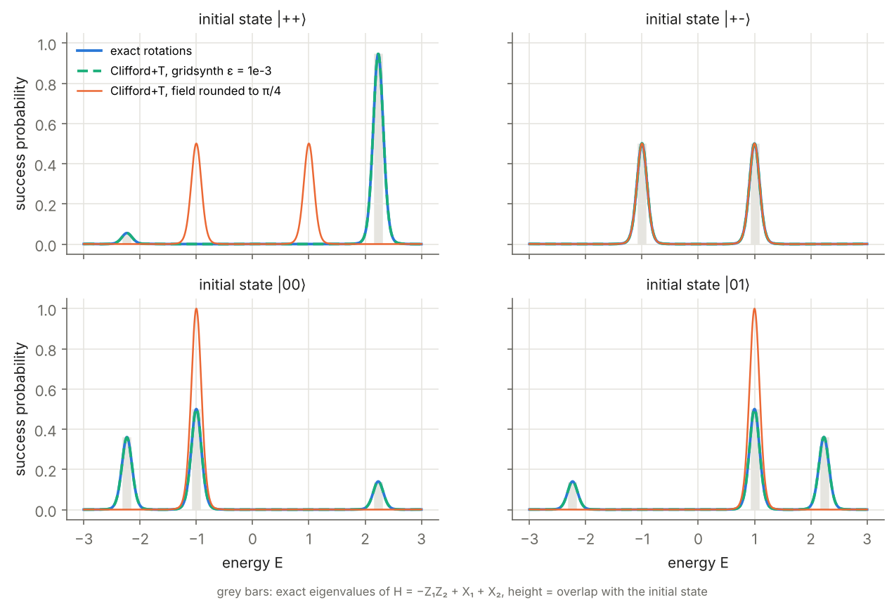
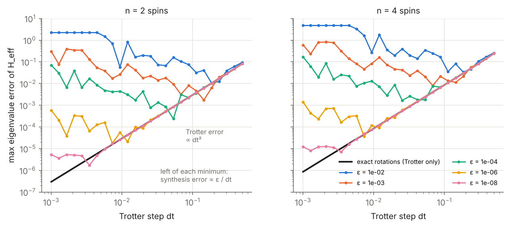
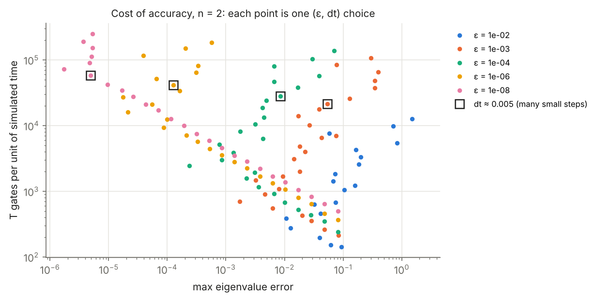
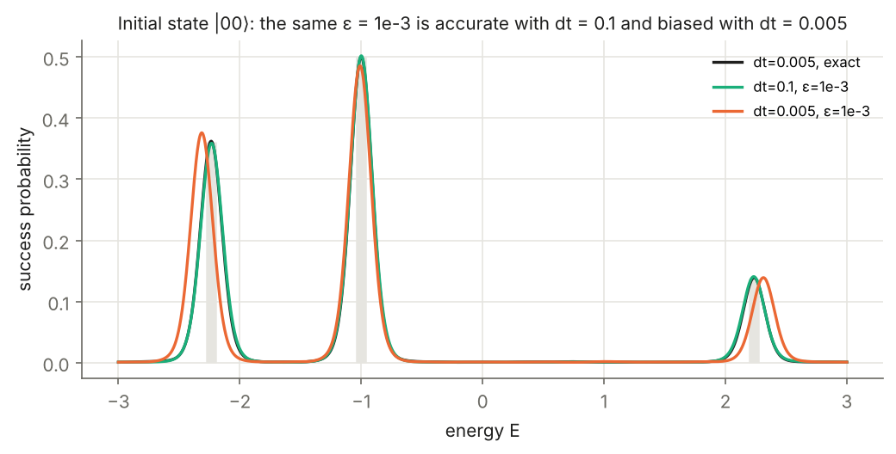

# Rodeo eigenvalue estimation with Clifford+T-compiled evolution

This repository asks how much gate-synthesis error the Rodeo algorithm can tolerate, and what accuracy costs in T gates, when the transverse-field Ising model is simulated on a Clifford+T gate set.

Rodeo finds eigenvalues by filtering a state through randomly timed, ancilla-controlled time evolutions. On fault-tolerant hardware, every rotation in those evolutions must be compiled into Clifford and T gates. Each compiled rotation then has a precision ε and a cost of about 3·log₂(1/ε) T gates. This repository compiles the evolution with Ross–Selinger approximation plus exact synthesis implemented with exact arithmetic in ℤ[1/√2, i]. It then measures how precision, Trotter step and T-count shape the spectrum that Rodeo returns.

The full write-up is [`docs/report.pdf`](docs/report.pdf).

<p align="center"></p>

## Results

**1. Compiled evolution recovers the exact spectrum, while diagonal rounding silently changes the model.** With rotations compiled at ε = 10⁻³ (green), the Rodeo peaks sit at the exact eigenvalues ±1 and ±√5 with the right weights. The tempting shortcut is to round each angle to the nearest multiple of π/4, i.e. to search only over diagonal Clifford+T gates. That maps the small field rotation to the identity, so the computation becomes the classical model −Z₁Z₂ (orange). Those spectra are clean and self-consistent, and wrong: |00⟩ shows a single level at −1 instead of three.

**2. Synthesis error grows as the time step shrinks.** The same angles repeat at every Trotter step, so synthesis errors accumulate coherently as ε/dt, while the Trotter error falls as dt². Each ε therefore has an optimal step, roughly dt* ∝ ε^{1/3}.

<p align="center"></p>

**3. Small steps are expensive twice over.** For two spins:

| Configuration | Eigenvalue error | T gates per unit time |
|---|---|---|
| ε = 10⁻⁴, dt = 0.005 | 6.9 × 10⁻³ | about 26,500 |
| ε = 10⁻³, dt = 0.14 | 1.7 × 10⁻³ | about 700 |

The second configuration is four times more accurate and needs 37 times fewer T gates. In a Rodeo spectrum, the mismatched choice shifts the ±√5 peaks by 0.08, about 40% of the peak width.

<p align="center">


</p>

## How it works

| Module | Role |
|---|---|
| `rodeo_ct/ring.py` | Exact arithmetic in ℤ[1/√2, i]: elements stored as (a + bω + cω² + dω³)/√2ᵏ |
| `rodeo_ct/exact_synthesis.py` | Kliuchnikov–Maslov–Mosca exact synthesis: peel the sde with HTᵏ steps, then look up the remainder in a 1664-entry BFS table |
| `rodeo_ct/synthesis.py` | Ross–Selinger Rz approximation via [pygridsynth](https://pypi.org/project/pygridsynth/), re-synthesised and verified exactly; π/4-rounding baseline |
| `rodeo_ct/tfim.py` | Transverse-field Ising Hamiltonian and first-order Trotter step, every rotation an Rz |
| `rodeo_ct/rodeo.py` | Rodeo success probability from the eigendecomposition of the compiled step |

The exact synthesis reproduces every Ross–Selinger word exactly, global phase included, with the same optimal T-count. The global phase matters because Rodeo uses controlled evolution, where a phase becomes an energy shift.

The Rodeo filter formula agrees with a full Qiskit statevector simulation of the ancilla circuit to 10⁻⁹, for exact and for compiled evolution.

## Reproduce

```bash
pip install -r requirements.txt
python -m pytest -q                  # ring arithmetic, exact synthesis, error bound, circuit cross-check
python scripts/run_experiments.py    # results/*.npz (about 30 s)
python scripts/make_figures.py       # figures/*.png
```

## Limitations and next steps

The simulations are noise-free and use first-order Trotter steps on at most 4 spins. Each controlled rotation is modelled as an ideal control of its compiled word; real hardware needs about two compiled rotations per controlled Rz, a constant factor on cost.

Natural extensions:
- higher-order product formulas, which move the optimum;
- mixing several compiled approximations per angle, to turn coherent synthesis errors into partly incoherent ones;
- larger chains.

## References

1. K. Choi, D. Lee, J. Bonitati, Z. Qian, J. Watkins, *Rodeo algorithm for quantum computing*, Phys. Rev. Lett. 127, 040505 (2021).
2. N. J. Ross, P. Selinger, *Optimal ancilla-free Clifford+T approximation of z-rotations*, Quantum Inf. Comput. 16, 901 (2016).
3. V. Kliuchnikov, D. Maslov, M. Mosca, *Fast and efficient exact synthesis of single-qubit unitaries generated by Clifford and T gates*, Quantum Inf. Comput. 13, 607 (2013).

— Minka Dubourg
